<div align="center">

# Setup Isolated Environment for Pentesting and Hacking Projects


**Kali Linux + Windows 10 + Android in Oracle VirtualBox**
</div>

---

## 📌 Project Overview

In this Project You will Learn about **HOW TO SETUP VIRTUAL ENVIRONMENT WITH KALI LINUX + WINDOWS + ANDROID** With Full Pentesting and Hacking Environment without damaging Your Main Computer.
We will setup on these machines/OS on single Network, Like they are connected on same Wifi or Ethernet...

---


## 🎯 Objectives

- Install and configure VirtualBox.
- Install Kali Linux, Windows and Android as a virtual machine.
- Create a private **NAT Network** for the cybersecurity lab.
- Configure network connectivity for Kali Linux, Windows and Android.
- Assign a consistent IP address to the all 3 Machines.
- Verify network connectivity and DNS resolution.
- Take a clean VM snapshot for recovery.
- Document the complete setup process.
- Prepare the environment for future cybersecurity projects.

---

## 🛡️ Purpose of the Lab

The lab provides an isolated and controlled environment for cybersecurity learning and authorized security testing.
It can be used for activities such as:

- Network reconnaissance **(Nmap, Shodan, Recon-NG, Maltego, Amass)**
- Port scanning **(Nmap, RustScan, Netcat)**
- Vulnerability assessment **(Nessus, OpenVAS, Nikto)**
- Packet analysis **(Wireshark, tcpdump, Zeek)**
- Web security testing **(Burp Suite, SQLMap, OWASP ZAP)**
- Exploitation practice **(MetaSploit, Silver, BeEF)**
- Security-tool experimentation **(Kali Linux, ParrotOS, BlackArch)**

⚠️ **Important:** This laboratory must only be used for systems that you own or have explicit permission to test. Do not use the lab or its tools to attack unauthorized systems.

---

## ⚙️ Lab Configuration

| 🧩 Component       | ⚙️ Configuration   |
| ------------------ | ------------------  |
| 🖥️ Host OS         | Windows 11         |
| 🧠 Host RAM        | 16 GB               |
| ⚡ Processor       | Intel Core i7      |
| 🧰 Hypervisor      | VirtualBox 7.2    |
| 🌐 Virtual Network | NAT Network        |
| 📡 Network Address | 10.0.0.0/24        |
| 🐉 Security OS     | Kali Linux 2026.2  |
| 🧠 Kali RAM        | 2048 MB            |
| 🐧 Kali IP Address | 10.0.0.2/24        |
|🖥️Test OS              |Windows10 and Androidx86|
|🧠Windows RAM          |4096 MB            |
|🖥️Windows 10 IP Address|10.0.0.10/24       |
|🧠Android RAM          |2048 MB            |
|🖥️Android-x86 IP Address  |10.0.0.9/24    |
| 🚪 Default Gateway | 10.0.0.1           |
| 🌍 DNS Server      | 8.8.8.8            |
| 🔮 Future VM Range | 10.0.0.3–10.0.0.99 |

---

# 🪜 Lab Setup Procedure

## Step 1. Install 7-Zip

7-Zip was installed to extract the Kali Linux virtual-machine package, which may be distributed as a `.7z` archive.

**Tool:** 7-Zip

---

## Step 2. Install VirtualBox

VirtualBox was installed as the hypervisor.

---

## Step 3. Create the NAT Network

A dedicated NAT Network was created in VirtualBox.

Configuration:
Network Name: NatNetwork1
IPv4 Prefix:  10.0.0.0/24
DHCP:         Enabled
IPv6:         Disabled
Make Sure Virtual Cable Connected.

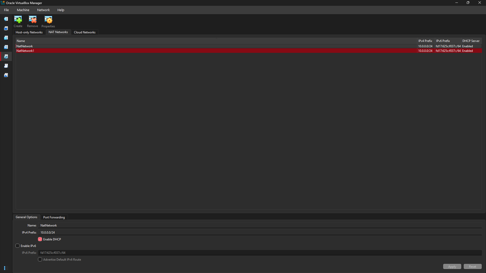

A **NAT Network** was selected because multiple virtual machines connected to the same NAT Network can communicate with one another while also having outbound network connectivity.

This will allow future attacker and target VMs to communicate within the lab.
---

# Step 4. 

## Import Kali Linux

The Kali Linux virtual machine was downloaded from the official Kali Linux website and imported into VirtualBox.

The VM network adapter was configured as follows:

```text
Adapter 1
Attached to: NAT Network
Network:     NatNetwork1
Adapter Type: Intel PRO/1000 MT Desktop
```

The VM was allocated:

```text
RAM: 2048 MB
```
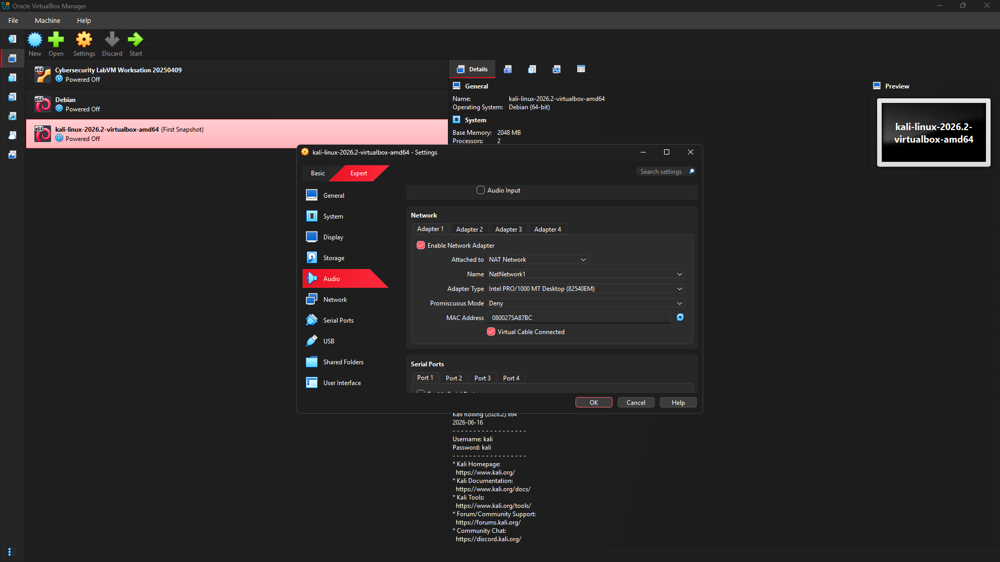
A shared folder was also configured for transferring required files between the host operating system and the Kali VM.

---

## Configure the Kali Linux Network

The Kali Linux network configuration was checked and configured with a consistent IPv4 address.

Example configuration:

```text
IP Address: 10.0.0.2
Subnet Mask: 255.255.255.0
Gateway: 10.0.0.1
DNS: 8.8.8.8
```

A consistent IP address makes it easier to document the lab and reference the Kali machine in future exercises.

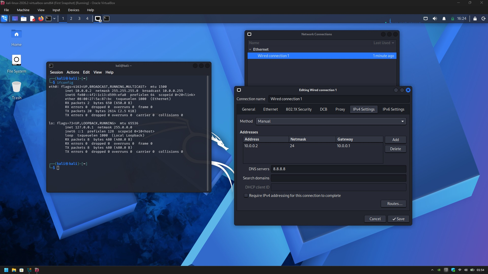

**This Image Shows Correct Image of Kali IP Address**

---

## Create a Clean VM Snapshot

After completing the initial configuration, a VirtualBox snapshot was created.

Example snapshot name:

```text
Clean Kali - Network Setup
```

The snapshot represents the clean baseline of the laboratory.

If a future exercise changes or damages the VM configuration, the machine can be restored to this baseline.

---

## Install Windows 10

The Windows10 ISO File was downloaded from the official Microsoft website and Setup into VirtualBox.

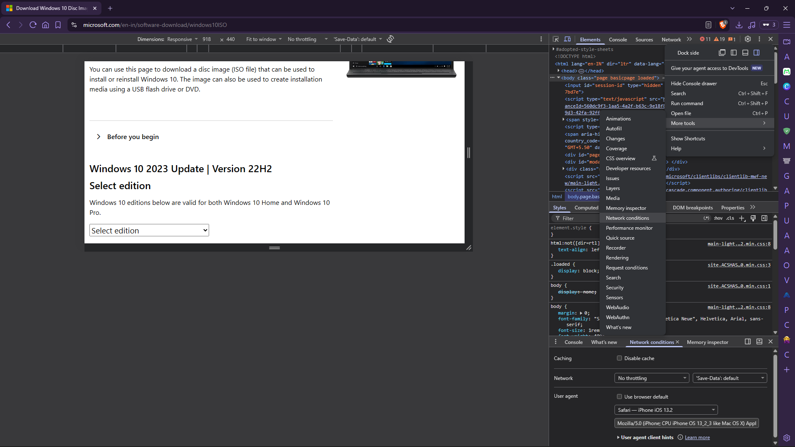

The VM network adapter was configured as follows:

```text
Adapter 1
Attached to: NAT Network
Network:     NatNetwork1
Adapter Type: Intel PRO/1000 MT Desktop
```

The VM was allocated:

```text
RAM: 4096 MB
```

---

## Configure the Windows 10 Network

The Windows 10 network configuration was checked and configured with a consistent IPv4 address.

Example configuration:

```text
IP Address: 10.0.0.10
Subnet Mask: 255.255.255.0
Gateway: 10.0.0.1
DNS: 8.8.8.8
```

A consistent IP address makes it easier to document the lab and reference the Windows 10 in future exercises.

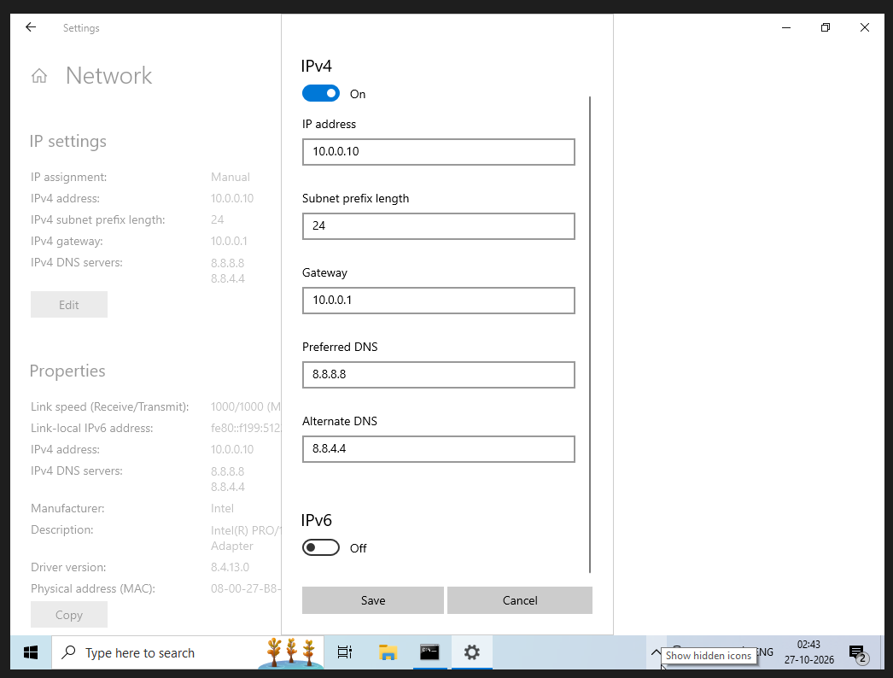

**This Image Shows Correct Image of Windows 10 Address**

---

## Install Android-x86

The Android-x86 ISO File was downloaded from the official Android-x86 website and Setup into VirtualBox.

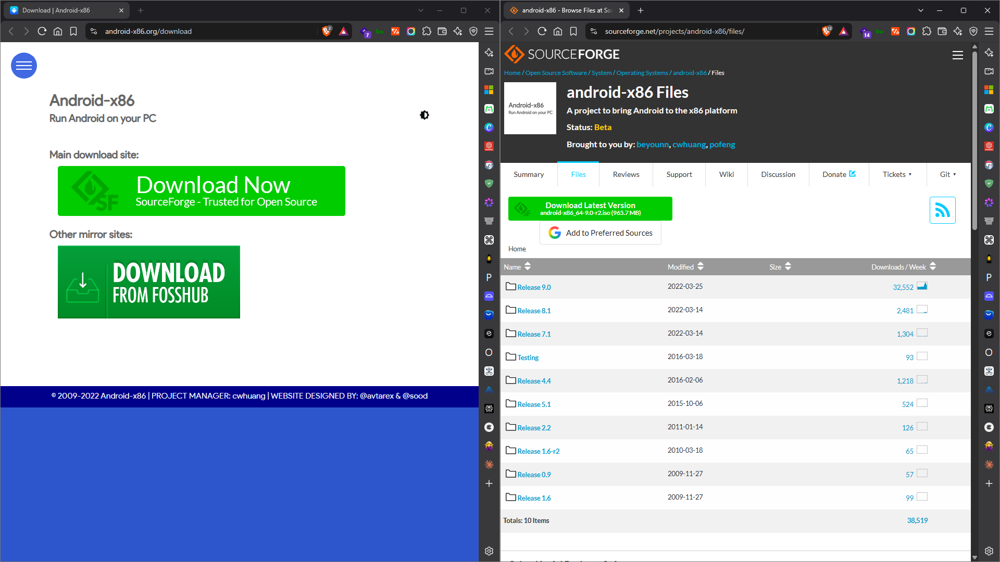

The VM network adapter was configured as follows:

```text
Adapter 1
Attached to: NAT Network
Network:     NatNetwork1
Adapter Type: Intel PRO/1000 MT Desktop
```

The VM was allocated:

```text
RAM: 2048 MB
```

---

## Configure the Android-x86 Network

The Android-x86 network configuration was checked and configured with a consistent IPv4 address.

Example configuration:

```text
IP Address: 10.0.0.9
Subnet Mask: 255.255.255.0
Gateway: 10.0.0.1
DNS: 8.8.8.8
```

A consistent IP address makes it easier to document the lab and reference the Android-x86 in future exercises.

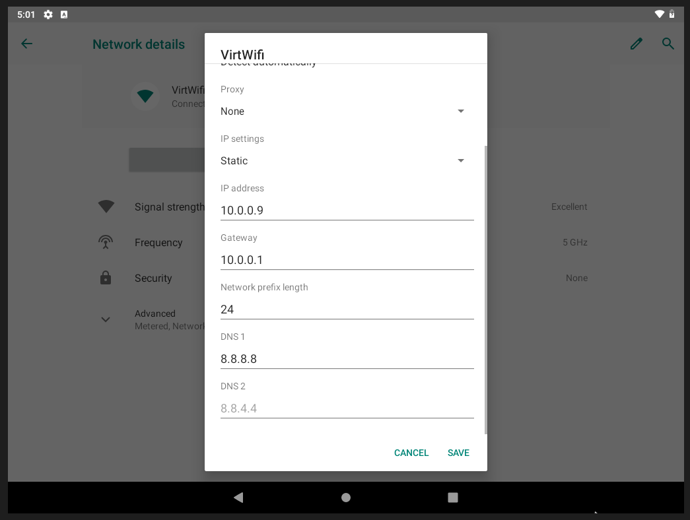

**This Image Shows Correct Image of Android-x86 Address**

---

# Ping Test of Android-x86 and Windows with Kali Linux

## Android-x86 with Kali Linux

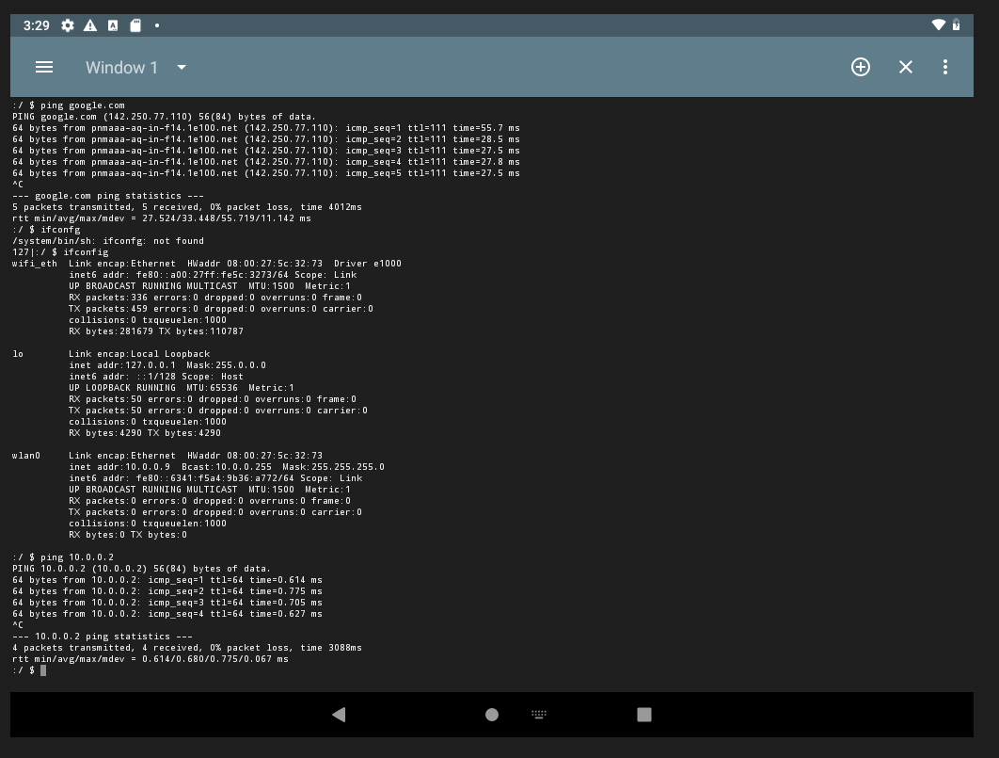

---

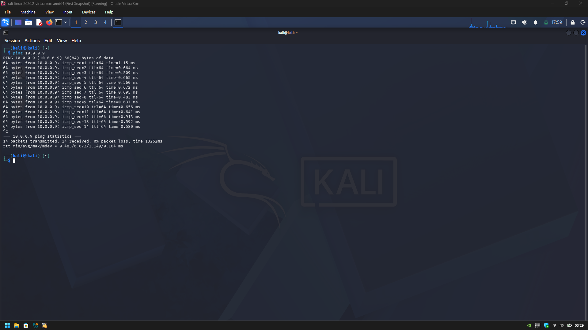

## Windows 10 with Kali Linux

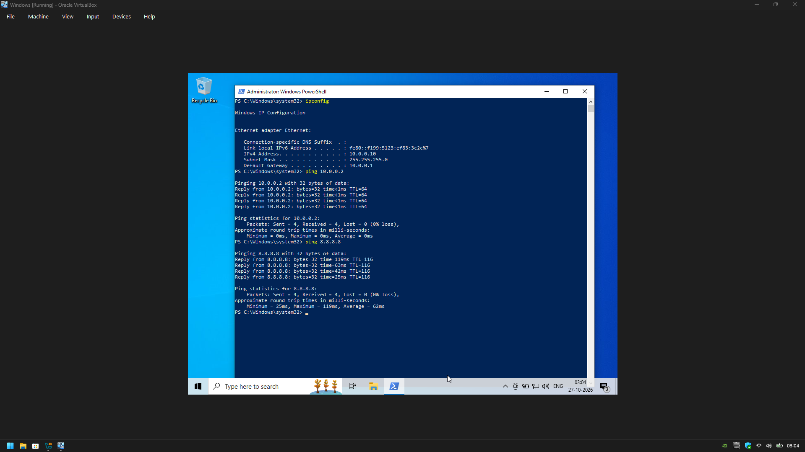

---

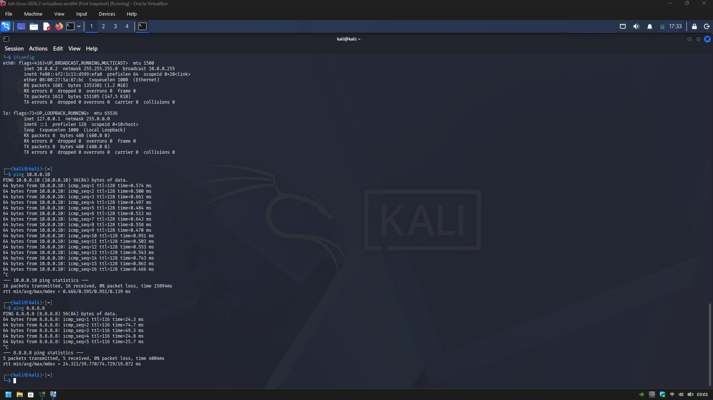

# 🐞 Problems Encountered & Solutions

Documenting problems is an important part of the project.

## Problem 1. Internet Connectivity After VM Freeze and Machine Returns to SnapShot | **Here The Snapshot Helped me**

After manually configuring the IPv4 settings, Internet connectivity may fail depending on the Kali/NetworkManager configuration.
One workaround used during this lab was:

```bash
sudo nmcli connection modify "Wired connection 1" ipv4.dad-timeout 0
sudo nmcli connection down "Wired connection 1"
sudo nmcli connection up "Wired connection 1"
```

The network connection was then restarted/rebooted and connectivity was tested again.

> **Important:** Network interface and connection names may differ between systems. Students should first identify their actual connection name before running an `nmcli` command.

---

## Problem 2. Windows Boot Loop

During Installation of Windows 10 on Virtualbox, After the First Reboot after windows 10 says, it installed successfully. then you see a line **Press any key to boot from CD or DVD._** .
It is a step we really **NOT** to press any key, just wait... Then You Got your window installed. and next time, remove the ISO File from Settings or Just Delete from your Host Downloads...

## Problem 3. Android-x86 Setup Issue

As Written in the Manual, I do the same step But it stuck/freeze at Boot ...
Then I researched and I found the best Solution...
When it says reboot or Run Android-x86 , Click Reboot then,
- choose Advanced Options
- Choose Boot from Local Drive
- press 'e' to  see Kernel option
- again press 'e' to edit the first line
- using arrow keys slide to **root=/dev/ram0** add **nomodeset xforcevesa** before **root**
```bash
  nomodeset xforcevesa root=/dev/ram0
```
- **Don't remove anything, Add in middle**
- Press Enter after Edit
- Press 'b' to boot
- then wait untill Android got its bootloader
- then press 'Alt+F1'
- run these commands
```bash
mkdir /mnt/sda
mount /dev/block/sda1/ /mnt/sda
vi /mnt/sda/grub/menu.lst
```
- This will open boot setting
- press 'i' for editing
- then add **nomodeset xforcevesa** before **root** in Title Android-x86 9.0-r2
```bash
  nomodeset xforcevesa root=/dev/ram0
```
- and at 2nd line, change timeout value from 6 to 2
- then press 'esc'
- then press ':'
- then write 'wq'
- then enter
- you will get to console again
- reboot and Wait, then your andriod will be booted without error

---

# 💡 What I Learned

Through this project, I learned how to create and configure a virtual environment for cybersecurity practice.

The most important concepts I learned include:

### 1. NAT vs NAT Network

A standard NAT configuration and a NAT Network serve different purposes.
A NAT Network allows multiple VMs connected to the same virtual network to communicate with one another while providing network address translation for external connectivity.
This makes it useful for building a multi-machine cybersecurity laboratory.

### 2. Virtual Machine Networking

I learned how VirtualBox virtual network adapters connect virtual machines to different types of networks and how network configuration affects communication between machines.

### 3. Static IP Configuration

I learned how to configure and verify IPv4 addressing, subnet masks, gateways, and DNS settings in Kali Linux, Windows 10 and Android-x86.

### 4. VM Snapshots

I learned that a clean snapshot should be created **before performing risky or experimental activities**.

This provides a known-good recovery point for future cybersecurity exercises.

### 5. Documentation

I learned that documenting commands, configuration, screenshots, problems, and solutions is an important part of a professional cybersecurity project.

---

# 🔐 Security & Ethical Use

This laboratory is intended strictly for education purposes only.

---

# 🔗 Tools & Resources

- **7-Zip:** [https://7-zip.org/download.html](https://7-zip.org/download.html)
- **VirtualBox:** [https://virtualbox.org/wiki/Downloads](https://virtualbox.org/wiki/Downloads)
- **Kali Linux:** [https://kali.org/get-kali](https://kali.org/get-kali)
- **Windows 10:** [microsoft.com/en-in/software-download/windows10iso](microsoft.com/en-in/software-download/windows10iso)
- **Android-x86:** [https://www.android-x86.org/download](https://www.android-x86.org/download)

---

# 👤 Author

**YASH MITTAL**\
InternID - NW-084-002

LinkedIn: [https://www.linkedin.com/in/nethunteryash/](https://www.linkedin.com/in/nethunteryash/)

---

## 📌 Project Information

**Program Name:** Cybersecurity at Networkwalks | **Week:** 01 | **Project:** Cybersecurity & Pentesting Lab Setup | **Repository:** GitHub
